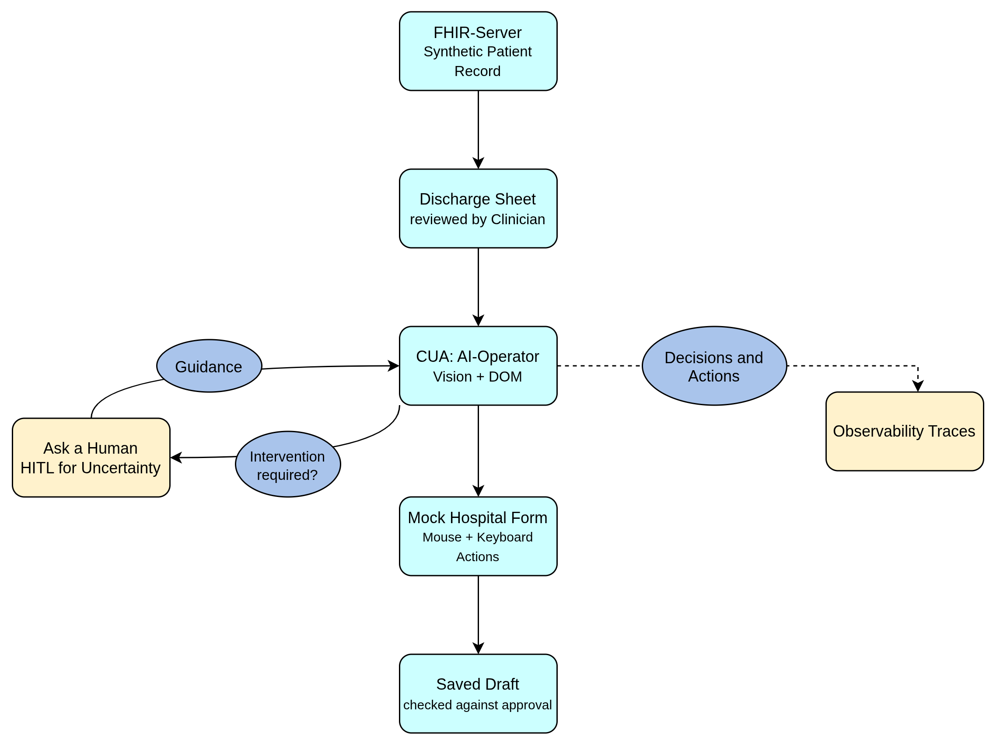
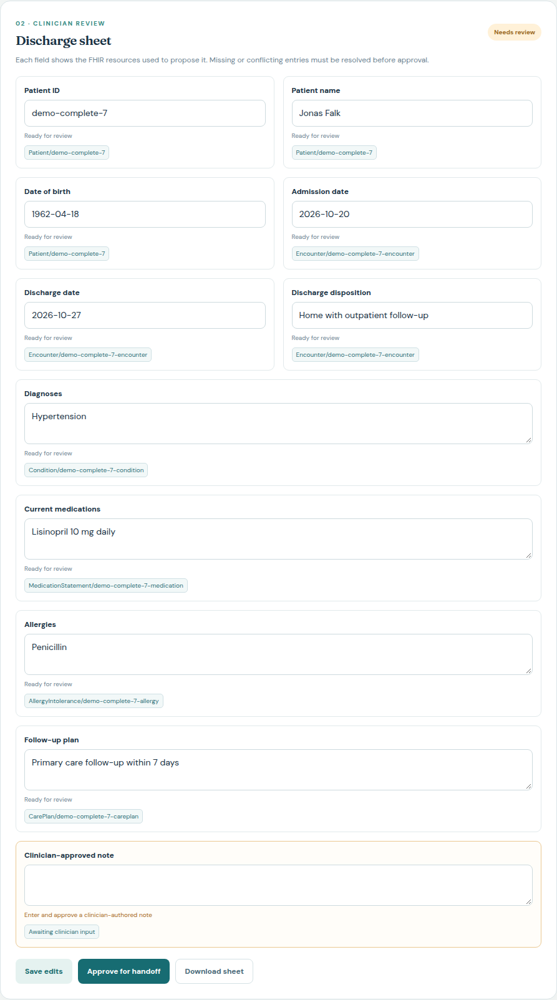
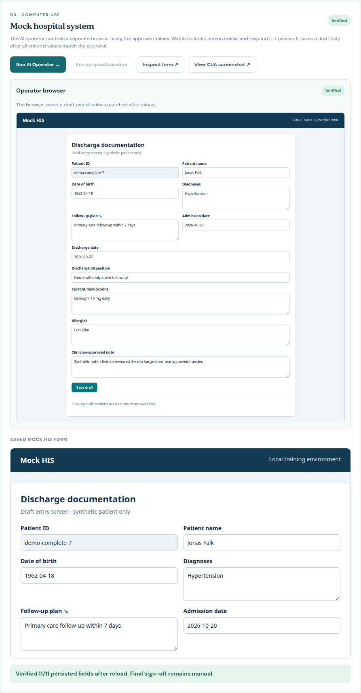
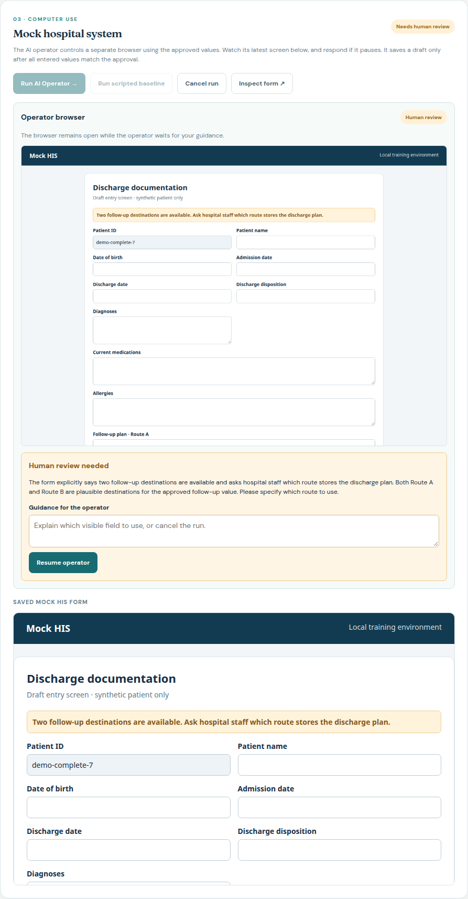
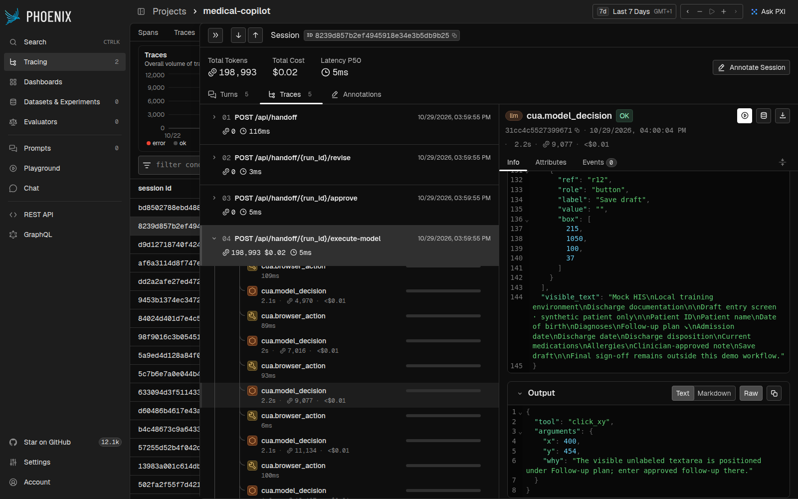

# Medical Co-Pilot: computer-use handoff PoC

This project began as an [agentic RAG clinical copilot](src/agents/graph.py) using FHIR patient data, medical guideline retrieval, and tool calls. The current demo focuses on a separate **computer-use agent (CUA)**: it transfers a clinician-approved discharge sheet into a mock hospital system using a real browser. All patient records in this workflow are synthetic.

**Status:** This is a proof of concept, not a finished clinical product. The target is a local mock HIS, and final clinical sign-off remains with a person.

## Workflow



The diagram shows the two human checkpoints: a clinician must approve the discharge sheet before browser entry, and the operator can pause for guidance when a form destination is unclear.

- **Prepare:** Deterministic mapping turns FHIR resources into a discharge sheet. Every proposed field links back to its source record; missing or conflicting data blocks approval until a clinician resolves it.
- **Operate:** `gpt-6-luna` receives only the approved field values and source references, plus a fresh **DOM summary and screenshot** of the mock HIS. It chooses one browser action per model call; Playwright performs the mouse and keyboard actions. The model cannot write directly to the HIS data store.
- **Check:** The app blocks Save draft until all fields equal the approved values. After saving, it reloads the form and verifies **11/11 persisted fields**. Uncertainty can pause the browser for human guidance.



*The sheet exposes the FHIR source for each field. The clinician adds a note and approves the exact packet sent to the operator.*

## CUA scenarios

Choose a synthetic patient and a **Mock HIS challenge** before **Prepare handoff**. Then add a clinician note, **Save edits**, **Approve for handoff**, and **Run AI Operator**.

| Form challenge | What it demonstrates |
| --- | --- |
| **Standard form** | Clearly labeled fields on one page. Compare the model with **Run scripted baseline**, which is available only here. |
| **Tabbed form** | The operator navigates between patient/stay and care/notes tabs as the visible DOM changes. |
| **Visual label challenge** | The follow-up field has a visible caption but no accessible label. The operator uses screenshot coordinates, then the mouse and keyboard. |
| **Ambiguous destination** | Two follow-up routes look plausible. The operator pauses; guide it to **Route B**, then select **Resume operator**. |
| **Transient save error** | The first save returns a synthetic error. The operator can retry or request guidance, with at most two save attempts. |

The patient choices test a different part of the workflow: **Complete discharge record** needs only the clinician note; **Missing follow-up plan** requires a clinician to supply a plan; **Conflicting medication entries** require a clinician to resolve the competing source values before approval.



*Visual-label run: the operator uses the screenshot for the unlabeled follow-up field; the saved draft passes the 11/11 reload check.*



*Ambiguous-destination run: the browser stays open while a person chooses the correct route. Guidance is returned to the model before it continues.*

## Phoenix observability

[Arize Phoenix](http://127.0.0.1:6006/) groups each workflow under the **session ID shown in the demo**. Open the `medical-copilot` project, find that ID in **Sessions**, and expand its **Traces**. The child spans show preparation and approval, `cua.model_decision` LLM calls with inputs, selected tool and short reason, `cua.browser_action` tool calls, save errors, token use, and verification. Generic HTTP root spans can show blank input/output; inspect the child spans for the model exchange. Model content capture here is restricted to the synthetic handoff workflow.



*Phoenix trace from the visual-label run, linked to the same ID displayed in the app.*

## Run locally

From the repository root, use Python 3.12, Docker, Playwright Chromium, and a valid `OPENAI_API_KEY` in the project `.env` file or shell (see `env.example`). The AI Operator makes paid model calls.

```bash
python3.12 -m venv .venv-handoff
source .venv-handoff/bin/activate
pip install -r requirements-handoff.txt
python -m playwright install chromium
docker compose up -d hapi-fhir phoenix
python scripts/seed_handoff.py
HANDOFF_FHIR_SOURCE=live uvicorn src.handoff.app:app --host 127.0.0.1 --port 8768
```

Open the [demo](http://127.0.0.1:8768/) and [Phoenix](http://127.0.0.1:6006/). If FHIR is still starting, retry the seed command. For an offline FHIR fixture, start with `HANDOFF_FHIR_SOURCE=fixture`. See [the demo guide](docs/HANDOFF_DEMO.md) for a fuller walkthrough and checks.

## Scope and next steps

This PoC runs against an invented browser form, uses in-memory run state, and is **not** connected to a real hospital system or approved for real patient data. Work toward real-world reliability includes broader form and failure evaluations, more robust recovery across changing interfaces, durable resumable runs, and production-grade access and privacy controls.
